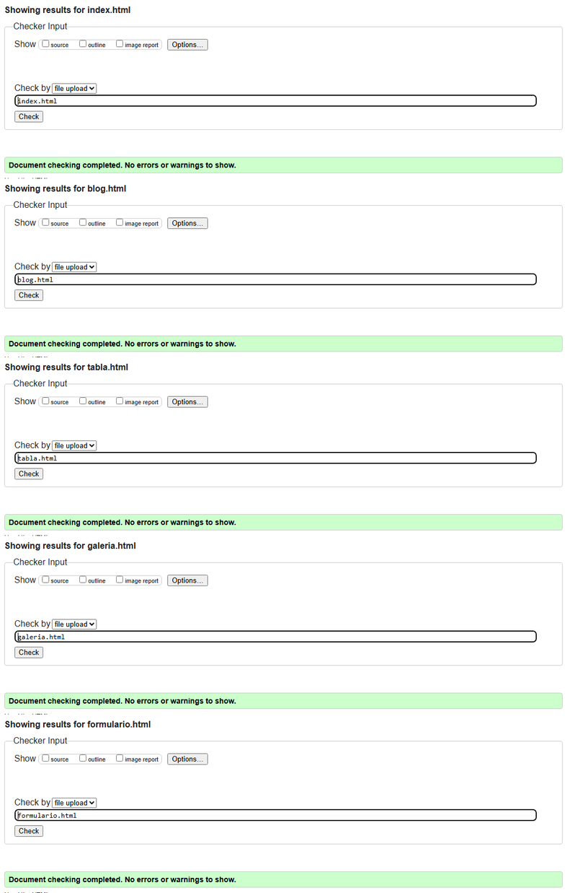
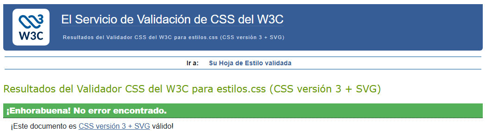
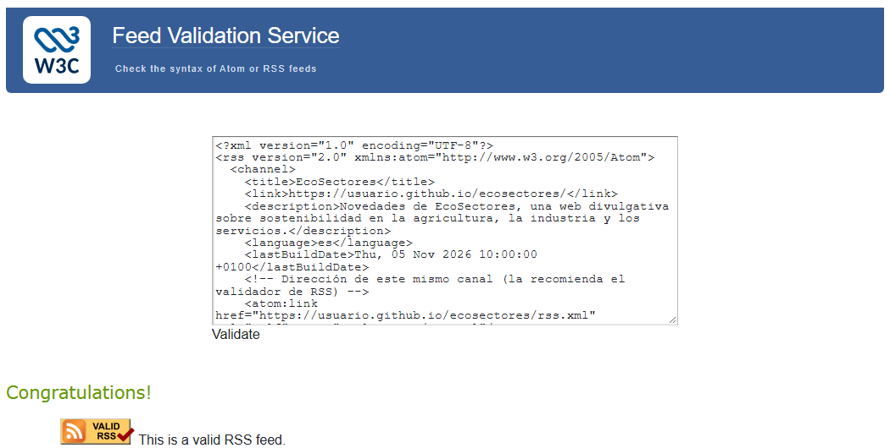

# EcoSectores

Sitio web divulgativo sobre **sostenibilidad en los sectores productivos**: qué pueden hacer la agricultura, la pesca, la industria, la energía, el transporte y los servicios para contaminar menos, ahorrar recursos y aprovechar sus residuos. Incluye un artículo, una tabla con datos oficiales de emisiones de 2024, una galería multimedia y un formulario de inscripción a unas jornadas.

## Autoría

- Nombre y apellidos: Samuel Hurtado Afonso
- Curso: 1.º DAM
- Módulo: Lenguajes de Marcas y Sistemas de Gestión de Información (LMSGI)
- Fecha: noviembre de 2026

## Sitio publicado

- Web en GitHub Pages: [Abrir sitio](https://shurafo451.github.io/ecosectores/)
- Repositorio: [Abrir repositorio](https://github.com/Shurafo451/ecosectores)

## Ver la web en local

Si se abren los archivos con doble clic (`file:///...`), el vídeo de YouTube muestra el **error 153**. Para verla completa en el ordenador hay que servirla con un servidor local. Por ejemplo, desde la carpeta del proyecto:

```
python -m http.server 8000
```

y después abrir `http://localhost:8000/` en el navegador. También sirve la extensión Live Server de Visual Studio Code.

## Estructura del proyecto

```
ecosectores/
├── index.html
├── blog.html
├── tabla.html
├── galeria.html
├── formulario.html
├── rss.xml
├── README.md
├── css/
│   └── estilos.css
├── img/          (fotos JPG y WebP, icono PNG, logotipo, favicon y SVG)
├── audio/        (dos audios, cada uno en MP3 y OGG)
├── video/        (vídeo en MP4 y WebM)
└── subtitulos/   (subtitulos-es.vtt y subtitulos-en.vtt)
```

- `index.html`: portada. Presenta el sitio, el logotipo y el tema, resume los otros cuatro contenidos con imagen, fecha y enlace, incluye un `aside` con un dato curioso y una lista de enlaces externos.
- `blog.html`: artículo «Producir sin agotar el planeta», con índice interno, cita, lista anidada, esquema en `pre` y notas al pie.
- `tabla.html`: emisiones de gases de efecto invernadero de España en 2024 por sector productivo y actividad, con `rowspan` para agrupar las actividades de cada sector y `colspan` para agrupar las dos columnas de emisiones.
- `galeria.html`: 12 imágenes en varios formatos, mapa de imagen con tres zonas, vídeo local con dos pistas de subtítulos, dos audios locales, un vídeo de YouTube y un mapa de Google Maps.
- `formulario.html`: inscripción en las Jornadas de Producción Sostenible 2026, con cuatro `fieldset` y validación HTML.
- `rss.xml`: canal RSS 2.0 con cuatro elementos, uno por cada página de contenido.
- `css/estilos.css`: estilos básicos compartidos por las cinco páginas.

## Tecnologías utilizadas

- HTML5
- CSS
- XML y RSS
- SVG (logotipo, favicon, diagrama y animación)
- Git
- GitHub
- GitHub Pages

## Características principales

- Navegación entre cinco páginas con un menú común que marca la página actual.
- Uso de HTML semántico (`header`, `nav`, `main`, `section`, `article`, `aside`, `footer`, `figure`, `time`, `address`…).
- Enlaces internos, externos, a secciones de la misma página y para volver al principio.
- Tabla accesible con `caption`, `thead`, `tbody`, `tfoot`, `scope`, `rowspan` y `colspan`.
- Galería con imágenes JPG, WebP, PNG transparente, SVG y SVG animado.
- Contenido multimedia: vídeo con póster y subtítulos en dos idiomas, y dos grabaciones de audio reales con su descripción.
- Formulario con validación HTML (`required`, `pattern`, `min`, `max`, `minlength`, `maxlength`…).
- Canal RSS enlazado desde el `head` de todas las páginas y desde el pie.

## Validación

Las cinco páginas, la hoja de estilos y el canal RSS se han validado con los validadores del W3C sin errores.

### HTML



### CSS



### RSS



El validador de RSS muestra una recomendación («Self reference doesn't match document location») solo cuando se valida el texto pegado, porque el canal indica su propia dirección en GitHub Pages. Al validarlo con la URL publicada desaparece.

## Dificultades encontradas

1. **Nombres de archivo de las imágenes descargadas.** Las fotos de Wikimedia Commons tenían espacios, tildes y extensiones en mayúsculas (`.JPG`, `.jpeg`). Como GitHub Pages distingue entre mayúsculas y minúsculas, una ruta como `img/Foto.JPG` puede funcionar en Windows y fallar al publicar. Lo resolví renombrando todos los archivos en minúsculas, sin espacios ni tildes, y volviendo a guardar cada imagen en su formato (no solo cambiando la extensión).
2. **Coordenadas del mapa de imagen.** Las coordenadas de `area` se miden en píxeles sobre la imagen, así que tuve que crear la imagen con un tamaño fijo (900 × 400) y calcular cada zona: un rectángulo, un círculo (centro y radio) y un hexágono (seis vértices). Si la pantalla es más estrecha y la imagen se reduce, las zonas dejan de coincidir; por eso también hay enlaces de texto al artículo.
3. **Errores y avisos de validación.** En el esquema del blog, las flechas `<--` no se pueden escribir tal cual dentro de `pre`, porque el `<` se interpreta como el inicio de una etiqueta; lo resolví escribiendo `&lt;--`. En el formulario, el validador avisó de que el atributo `inputmode` no es compatible con todos los navegadores, así que lo quité y usé `type="tel"` para el teléfono.
4. **Encontrar un vídeo con licencia libre y subtítulos.** Necesitaba un vídeo que pudiera alojar en mi propio repositorio y que tuviera subtítulos en dos idiomas. Lo encontré en Wikimedia Commons (CC BY 3.0), pero pesaba 32 MB en 1080p, así que lo convertí a 480p en MP4 y WebM (unos 10 MB cada uno). Además, los subtítulos en español venían marcados como español de Latinoamérica (`es-419`); en el `track` usé `srclang="es"`.
5. **Error 153 en el vídeo de YouTube.** Al abrir la galería con doble clic, el vídeo incrustado mostraba «Error de configuración del reproductor de vídeo (153)». YouTube exige saber desde qué web se incrusta el vídeo (la cabecera *Referer*), y un archivo abierto como `file://` no tiene dirección web. Lo resolví añadiendo `referrerpolicy="strict-origin-when-cross-origin"` al `iframe` y viendo la web en local con un servidor (`python -m http.server`). En GitHub Pages funciona sin hacer nada más.

## Decisiones técnicas

- **Organización de archivos:** cada tipo de recurso tiene su carpeta (`css`, `img`, `audio`, `video`, `subtitulos`) y todos los nombres están en minúsculas, sin espacios y son descriptivos (`riego-por-goteo.jpg`, `sonido-aerogenerador.mp3`).
- **Partes repetidas de la plantilla:** el `head` (codificación, `viewport`, favicon, hoja de estilos y RSS), la cabecera con el logotipo y el menú, y el pie con la autoría, el contacto en `address`, el enlace al RSS y el enlace para volver al principio.
- **Partes que cambian en cada página:** el `title`, la `meta description`, el `h1`, el contenido de `main` y la página marcada como actual en el menú (`class="actual"` y `aria-current="page"`).
- **Formatos de imagen:**
  - JPG para las fotografías, porque tienen muchos colores y comprimen bien.
  - WebP para dos fotografías (autobús y jardín vertical), porque ocupan menos que un JPG con una calidad similar.
  - PNG para el icono de la gota, porque necesita fondo transparente y bordes nítidos.
  - SVG para el logotipo, el favicon y el diagrama de economía circular, porque son vectoriales, ocupan poco y se ven nítidos a cualquier tamaño.
  - SVG animado para el aerogenerador, porque se mueve sin JavaScript y pesa mucho menos que un GIF.
  - PNG también para las capturas de validación, porque contienen texto que debe leerse con nitidez.
- **Imágenes optimizadas:** las fotos se han reducido a 800 px de ancho (1200 px la de portada). Todas tienen `width` y `height` y las que no se ven al cargar la página usan `loading="lazy"`.
- **Rutas relativas:** todos los recursos locales se enlazan con rutas relativas (`css/estilos.css`, `img/logo.svg`, `blog.html#primario`). Solo son absolutas las URL externas y las del RSS, porque un lector de RSS necesita la dirección completa.
- **Multimedia:** el vídeo y los audios tienen dos formatos (MP4/WebM y MP3/OGG) para que el navegador use el primero que pueda reproducir. Todos incluyen una descripción del contenido y el vídeo, además, subtítulos en dos idiomas.
- **Formulario:** `action="#"` y `method="post"` porque es una demostración sin servidor; se usa `post` porque el formulario incluye una contraseña y un archivo (por eso también `enctype="multipart/form-data"`). El botón «Guardar como borrador» lleva `formnovalidate` para poder guardar el formulario aunque falten campos obligatorios.
- **Preparación para la práctica de CSS:** el HTML no contiene estilos en línea ni atributos de presentación. Todo el aspecto está en una única hoja externa, muy básica, y hay clases (`actual`, `galeria`, `nombre-sitio`, `obligatorio`) que servirán para ampliar el diseño.

## Fuentes y licencias

### Imágenes (Wikimedia Commons)

| Archivo | Autoría | Licencia | Original |
|---|---|---|---|
| `img/portada.jpg` | MottaW | CC BY-SA 4.0 | [Parque-eolico-brulles-las-hormazas-marzo-2022-d.jpg](https://commons.wikimedia.org/wiki/File:Parque-eolico-brulles-las-hormazas-marzo-2022-d.jpg) |
| `img/planta-solar-ps10.jpg` | Benjamín Núñez González | CC BY-SA 4.0 | [Planta termosolar PS10, 0.1, Sevilla, España, 2015.JPG](https://commons.wikimedia.org/wiki/File:Planta_termosolar_PS10,_0.1,_Sevilla,_Espa%C3%B1a,_2015.JPG) |
| `img/riego-por-goteo.jpg` | Agne27 (Wikipedia en inglés) | Dominio público | [Drip irrigation system.JPG](https://commons.wikimedia.org/wiki/File:Drip_irrigation_system.JPG) |
| `img/agricultura-ecologica.jpg` | Hajhouse | Dominio público | [Organic-vegetable-cultivation.jpeg](https://commons.wikimedia.org/wiki/File:Organic-vegetable-cultivation.jpeg) |
| `img/saca-del-corcho.jpg` | JopkeB | CC BY-SA 4.0 | [Loading cork oak bark in Reserva Nacional de Cortes de la Frontera 1987.jpg](https://commons.wikimedia.org/wiki/File:Loading_cork_oak_bark_in_Reserva_Nacional_de_Cortes_de_la_Frontera_1987.jpg) |
| `img/reciclaje-clasificacion.jpg` | STEINERT | CC BY 4.0 | [STEINERT UniSort PR.jpg](https://commons.wikimedia.org/wiki/File:STEINERT_UniSort_PR.jpg) |
| `img/autobus-electrico.webp` | Maksym Kozlenko | CC BY 4.0 | [2024-0=424 Electric bus charging in Warsaw.jpg](https://commons.wikimedia.org/wiki/File:2024-0%3D424_Electric_bus_charging_in_Warsaw.jpg) |
| `img/jardin-vertical.webp` | Zarateman | CC0 | [Madrid - CaixaForum, jardín vertical 1.jpg](https://commons.wikimedia.org/wiki/File:Madrid_-_CaixaForum,_jard%C3%ADn_vertical_1.jpg) |
| `img/fabrica-paneles-solares.jpg` | Out Walking | CC BY-SA 4.0 | [Rose Calendars Solar Panels.jpg](https://commons.wikimedia.org/wiki/File:Rose_Calendars_Solar_Panels.jpg) |
| `img/barco-pesca-torrevieja.jpg` | Keith Williamson | CC BY 2.0 | [Fishing boat, Torrevieja.jpg](https://commons.wikimedia.org/wiki/File:Fishing_boat,_Torrevieja.jpg) |

Las fotos se han redimensionado y convertido de formato. Las que tienen licencia CC BY-SA se comparten con la misma licencia.

### Recursos propios

- `img/logo.svg`, `img/favicon.svg`, `img/economia-circular.svg`, `img/aerogenerador-animado.svg` e `img/icono-ahorro-agua.png`: creación propia.
- `img/mapa-sectores.jpg`: composición propia con fotos de Hajhouse, Out Walking y Maksym Kozlenko. Licencia CC BY-SA 4.0.
- Textos de todas las páginas: redacción propia.

### Vídeo

- `video/economia-circular.mp4` y `.webm`: Ellen MacArthur Foundation, [Explaining the Circular Economy and How Society Can Re-think Progress - Animated Video Essay.webm](https://commons.wikimedia.org/wiki/File:Explaining_the_Circular_Economy_and_How_Society_Can_Re-think_Progress_-_Animated_Video_Essay.webm), licencia [CC BY 3.0](https://creativecommons.org/licenses/by/3.0/). Convertido a MP4 (H.264) y WebM (VP9) de 480p.
- `subtitulos/subtitulos-es.vtt` y `subtitulos-en.vtt`: subtítulos del mismo archivo, aportados por la comunidad de Wikimedia Commons.
- `img/poster-video.jpg`: fotograma extraído del propio vídeo.

### Audio

- `audio/sonido-aerogenerador.mp3` y `.ogg`: Work With Sounds / Werstas, [WWS WindTurbine.ogg](https://commons.wikimedia.org/wiki/File:WWS_WindTurbine.ogg), licencia [CC BY 4.0](https://creativecommons.org/licenses/by/4.0/). Recodificado a MP3 y OGG.
- `audio/sonido-tractor.mp3` y `.ogg`: Sami Laaksonen para Work With Sounds / Werstas, [WWS JohnDeereTractor.ogg](https://commons.wikimedia.org/wiki/File:WWS_JohnDeereTractor.ogg), licencia [CC BY 4.0](https://creativecommons.org/licenses/by/4.0/). Recodificado a MP3 y OGG.

### Contenido externo y datos

- Vídeo de YouTube: [«La economía circular - El escarabajo verde»](https://www.youtube.com/watch?v=sSRUwdWo47I), publicado por Ecologistas en Acción.
- Mapa: Google Maps, ubicación de la planta solar PS10 (Sanlúcar la Mayor, Sevilla).
- Datos de emisiones: Ministerio para la Transición Ecológica y el Reto Demográfico, *Inventario nacional de emisiones de gases de efecto invernadero. Informe resumen. Edición 1990-2024* (2026), [Sistema Español de Inventario](https://www.miteco.gob.es/es/calidad-y-evaluacion-ambiental/temas/sistema-espanol-de-inventario-sei-.html).
- Definición de desarrollo sostenible: Comisión Mundial sobre el Medio Ambiente y el Desarrollo, *Nuestro futuro común* (1987), citada en [Naciones Unidas](https://www.un.org/es/ga/president/65/issues/sustdev.shtml).
